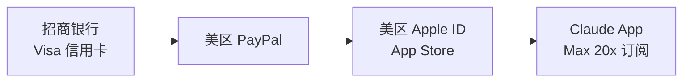
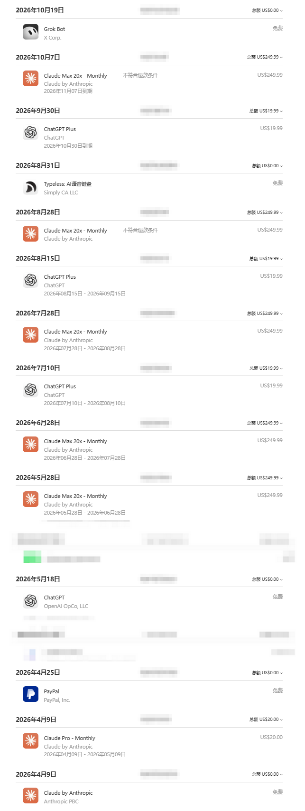
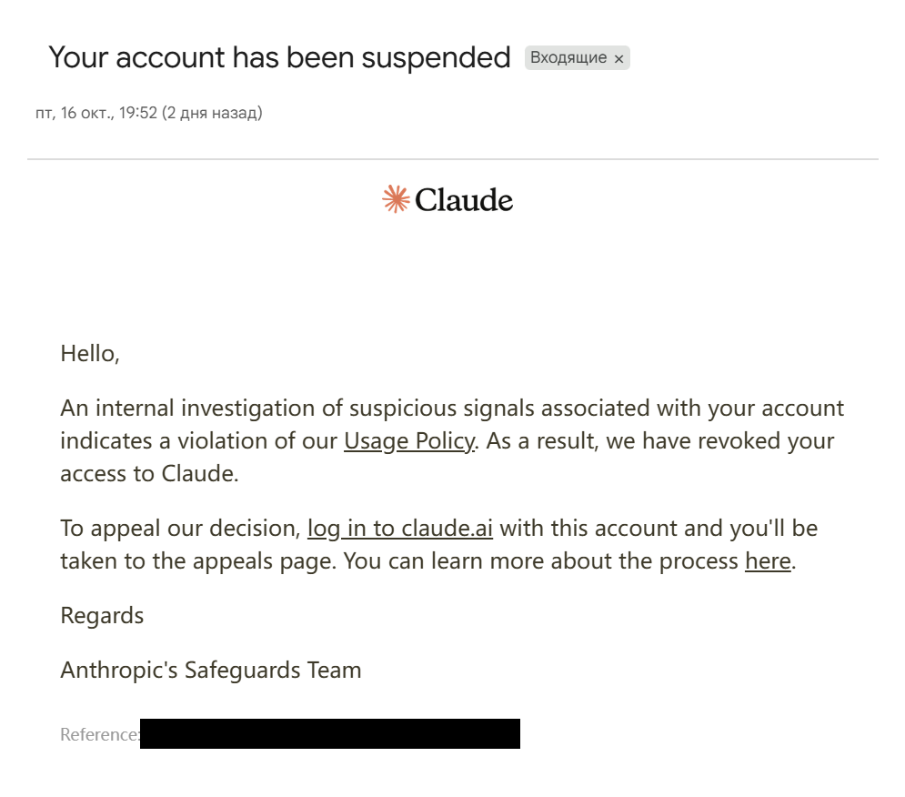
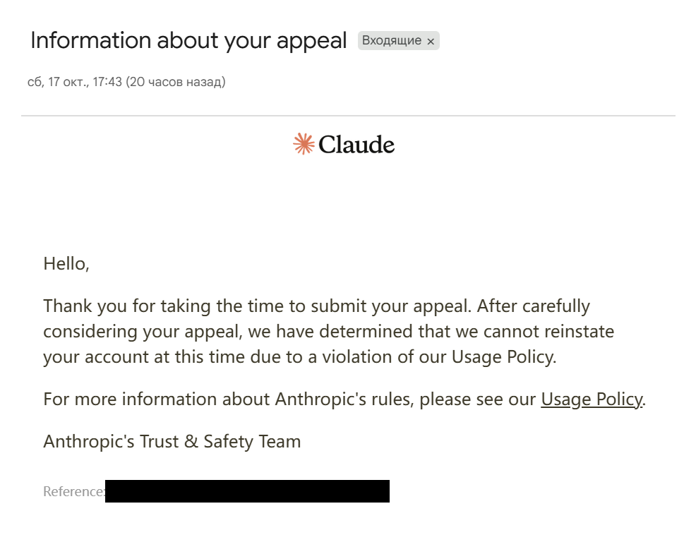
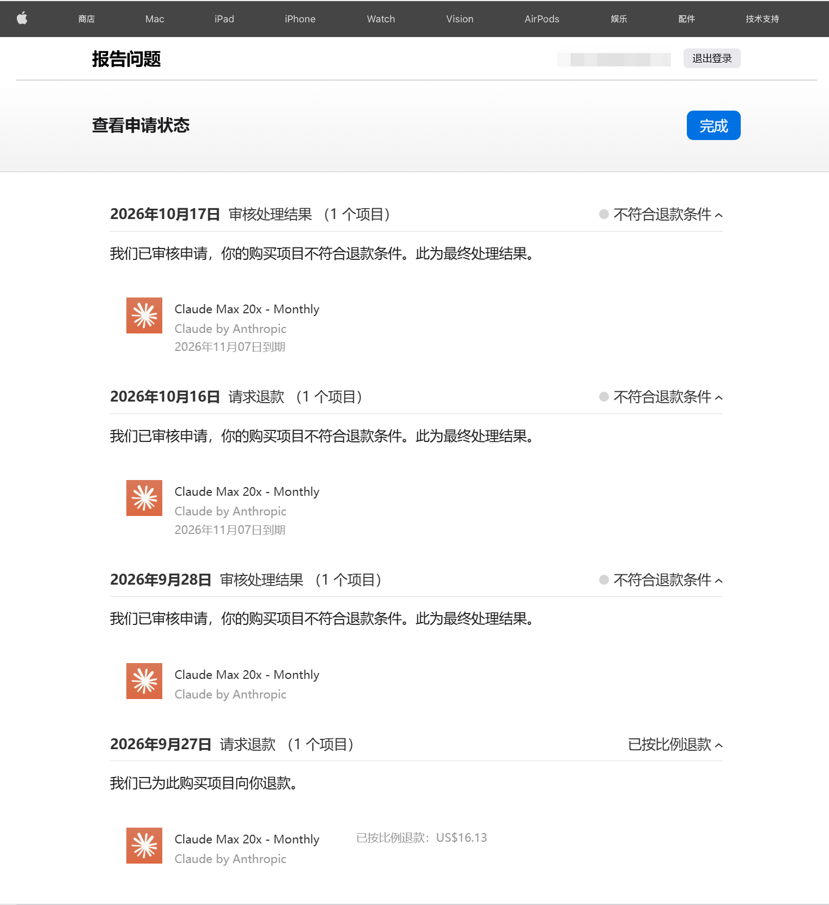
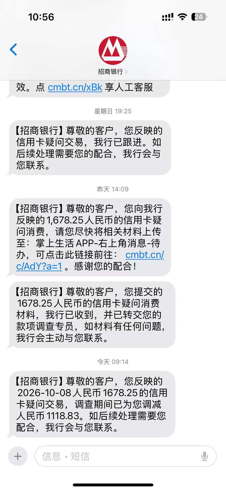
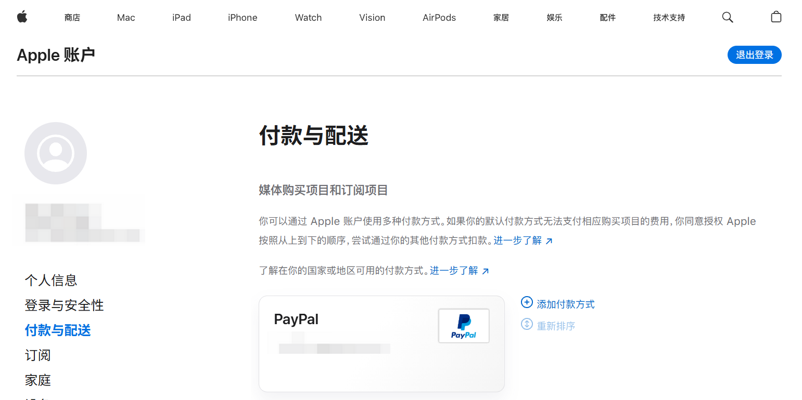
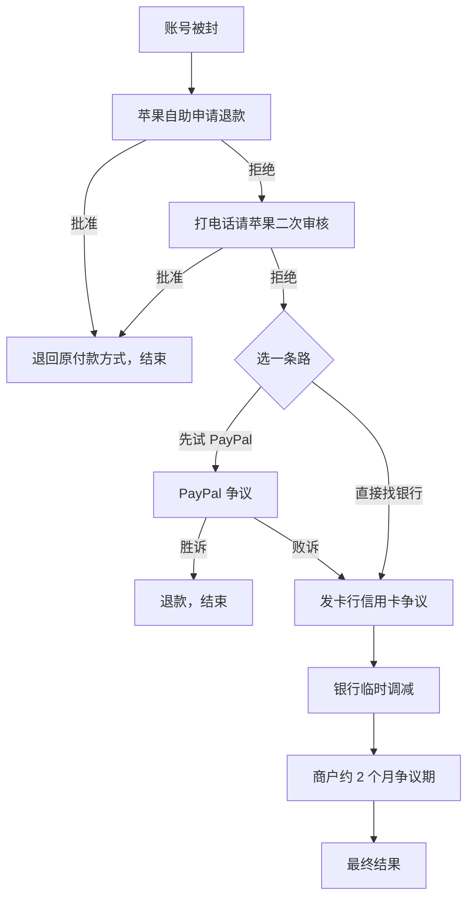

# Claude 被封、苹果拒退之后：我如何通过信用卡争议追回 2/3 订阅费

> **一句话总结**：我用「招行 Visa 信用卡 → 美区 PayPal → 美区 App Store」订阅 Claude Max 20x（US$249.99/月）。用了 9 天账号被封，苹果两次拒绝退款。最后我找发卡行招商银行发起信用卡争议，银行先为我调减了 **¥1,118.83**，约为这笔扣款（¥1,678.25）的 **2/3**。
>
> **状态（截至 2026-10-21）**：这是调查期间的**临时调减**，不是最终结果。商户还有约 2 个月可以抗辩，钱仍有可能被扣回。结果出来后我会更新。

这篇文章想回答两个问题：

1. **AI 账号被封、苹果又不退款时，还能做什么？**
2. **订阅之前，怎样设计付款方式，给自己多留几条退路？**

如果你只想看操作步骤，直接跳到 [第三部分](#三苹果拒退之后我走过的四步)。

## 目录

- [一、先看结论：三层退路](#一先看结论三层退路)
- [二、我的经历：两个账号，两次封禁](#二我的经历两个账号两次封禁)
- [三、苹果拒退之后：我走过的四步](#三苹果拒退之后我走过的四步)
- [四、订阅之前：付款结构怎么设计](#四订阅之前付款结构怎么设计)
- [五、风险和注意事项](#五风险和注意事项)
- [六、当前进展](#六当前进展)

---

## 一、先看结论：三层退路

我的付款链是这样的：

钱从信用卡出发，经过 PayPal、苹果，最后到 Anthropic。**链条上每一个环节，都是一个可以申诉的地方。** 前一层失败，还能找下一层：

| 层级 | 找谁 | 方式 | 我的结果 |
| --- | --- | --- | --- |
| 第 1 层 | 苹果 | 「报告问题」页面申请退款；再打电话请客服重新提交 | 两次都被拒，客服说无法再提第三次 |
| 第 2 层 | PayPal | 在 PayPal 发起争议（Dispute） | 处理中（见下方注意） |
| 第 3 层 | 发卡行（招商银行） | 信用卡争议，银行通过 Visa 向商户追款 | **临时调减 ¥1,118.83** |

> [!IMPORTANT]
> 第 2 层和第 3 层**只能选一个，顺序也有讲究**。PayPal 条款写明：同一笔交易不能同时在 PayPal 和发卡行争议；向发卡行发起后，PayPal 的案子会被关闭，以后也不能再找 PayPal。反过来，PayPal 判你输了，还可以再去找发卡行。详见 [第五部分](#五风险和注意事项)。

如果当初我用的是**礼品卡**，苹果拒退之后就没有第 2、3 层了——事情会在第 1 层结束。

---

## 二、我的经历：两个账号，两次封禁

### 时间线

| 日期（2026 年） | 发生了什么 |
| --- | --- |
| 4 月 9 日 | 第一个账号开通 Claude Pro（US$20/月） |
| 5 月 28 日 | 升级到 Max 20x（US$249.99/月），之后 6、7、8 月正常续费、正常使用 |
| 9 月 27 日 | **第一个账号被封**。当期订阅只剩约 1 天，苹果按比例退了 US$16.13 |
| 10 月 7 日 | 注册第二个账号，直接买 Max 20x，触发 KYC（身份验证）。我选了美国地区，用中国护照通过 |
| 10 月 16 日 | **第二个账号被封**，只用了 9 天。订阅本该到 11 月 7 日。当天向苹果申请退款，被拒 |
| 10 月 17 日 | Anthropic 驳回我的申诉；苹果第二次审核（电话客服代我提交）结果出来，仍然拒绝 |
| 之后 | 再打苹果电话，被告知不能再申诉；我在 PayPal 发起争议，又联系招商银行 |
| 约 4～5 个工作日后 | 招商银行在调查期间为我调减 ¥1,118.83 |

下图是我的 App Store 购买记录（订单号已打码）。从 4 月的 Pro，到 5～8 月每月的 Max 20x，再到 10 月 7 日第二个账号的订阅：

  

### 封禁邮件：只说违规，不说原因

10 月 16 日收到封禁邮件。邮件只说「内部调查发现可疑信号，违反了使用政策（Usage Policy）」，**没有说具体是哪一条**。

  

我按邮件提示提交了申诉。第二天收到回复：维持封禁，同样没有说明原因。

  

> [!NOTE]
> 我不知道自己具体触发了什么。但有一点要说清楚：**Claude 不向中国大陆提供服务**。从不支持的地区使用，本身就有被封的风险。这篇文章讲的方法只能**减少封号后的损失**，不能防止封号。

此时苹果订阅页上，订阅还显示「将于 11 月 7 日到期」——钱已经付了，服务却用不了：

  

---

## 三、苹果拒退之后：我走过的四步

### 第 1 步：在苹果「报告问题」页面申请退款

入口：[reportaproblem.apple.com](https://reportaproblem.apple.com) → 选择这笔订阅 → 「请求退款」。

我的结果如下图（从下往上看）：

- **9 月 27 日**（第一个账号被封）：已按比例退款 US$16.13。
- **10 月 16 日**（第二个账号被封）：「不符合退款条件。此为最终处理结果。」
- **10 月 17 日**（电话客服代我再次提交）：还是「不符合退款条件」。

  

页面写着「最终处理结果」，但**不要在这一步就放弃**。

### 第 2 步：打苹果客服电话，请求二次审核

- 电话：苹果中国客服 **400-666-8800**。
- 说明这是**外区（美区）账号的订阅账单**。国内客服会把你转到处理海外账单的团队。
- 我两次打电话，**每次都等了约 40 分钟**才接通。建议找一个空闲时间打。

第一次通话，客服帮我重新提交了退款申请。10 月 17 日结果出来，仍然拒绝，也没说原因。

第二次通话，客服告诉我：**一笔订单只有两次申诉机会**。第三次他无法再提交，这笔钱他也无权继续处理。

到这里，苹果这条路走完了。剩下大约 2/3 的订阅费（约 US$160），看起来要打水漂。

### 第 3 步：在 PayPal 发起争议

因为这笔钱是通过 PayPal 付给苹果的，PayPal 也是一个申诉入口。我在 PayPal 的「争议解决中心」对这笔付款发起了争议。截至写作时，状态仍是「处理中」。

> [!WARNING]
> 我是先开 PayPal 争议、后找银行的。后来查 [PayPal 条款](https://www.paypal.com/us/legalhub/paypal/buyer-protection)才知道：**一旦向发卡行发起争议，PayPal 会关闭你在 PayPal 的案子**。如果你还没开始，请先读 [第五部分](#五风险和注意事项)，想清楚走哪条路。

### 第 4 步：找发卡行发起信用卡争议（关键一步）

**信用卡争议**（英文叫 chargeback，也叫「拒付」）：你对一笔信用卡交易有异议时，可以请发卡银行出面，通过 Visa / 万事达卡组织向商户追回款项。它不需要商户同意，商户只能提交证据来抗辩。

这是我能追回钱的**关键**：苹果说了「不」，但 Visa 的争议规则不由苹果决定。

#### 4.1 打电话：让客服转给专业的同事

我打的是招商银行信用卡客服（**400-820-5555**）。

接电话的第一位客服不太了解这种情况：美区 PayPal、App Store、AI 订阅，听起来很复杂。对方的第一反应是让我「自己联系商户」。

**这时不要挂电话。** 我做了三件事：

1. **把整件事讲完整**：哪天付了多少钱、买的是什么、哪天服务停了、苹果怎么拒绝的。
2. **强调金额和严重性**：一千多元，服务只用了不到三分之一，商户明确拒绝退款。
3. **明确提出要求**：请登记为「信用卡疑问交易」，并转给处理争议的专业同事。

可以参考这段话：

> 「您好，我 10 月 8 日这张卡有一笔 1678.25 元的消费，是通过 PayPal 付给苹果的一个月 AI 软件订阅。10 月 16 日起这个服务就无法使用了，只用了 9 天。我已经向苹果申请了两次退款，都被拒绝，苹果客服说不能再申诉了。我手上有付款账单、服务停止的通知和苹果的拒绝记录。我想对这笔交易提出争议，请帮我登记疑问交易，并转给负责争议处理的同事。」

> [!CAUTION]
> **不要说成「盗刷」或「我没有授权」**。这笔交易是你自己付的，真实情况是「付了钱，但服务没有完整提供」。说假话可能让争议失败，还可能带来更大的麻烦。

#### 4.2 等专员回电，上传材料

大约 **2～3 个工作日**后，一位处理争议的专员回电，了解情况后，让我在「掌上生活」App 上传材料。银行短信里会给上传链接（路径：掌上生活 App → 右上角消息 → 待办）。

我上传了三样东西：

1. **App Store 收据**：证明买了什么、多少钱、订阅到哪天；
2. **PayPal 付款通知**：证明这笔钱从 PayPal（也就是这张信用卡）付给了 Apple；
3. **Claude 封禁邮件**：证明服务从哪天起中断。

  

#### 4.3 银行临时调减

上传后大约 **2 个工作日**，我收到短信：「调查期间已为您调减人民币 1118.83」。

  

几个要点：

- **¥1,118.83 正好是 ¥1,678.25 的 2/3**，和我没用完的订阅时间大致对得上。
- 「调减」是**临时**的。商户（苹果）还有约 **2 个月**的争议期，可以提交证据反驳。
- 如果商户抗辩成功，或者银行认为我的证据不够，这笔钱可能会被重新记回账单。银行也可能再找我补充材料。

> [!TIP]
> 注意日期：苹果记录的购买日是 10 月 7 日，银行短信里的交易日是 10 月 8 日（时差和入账时间造成）。**和银行沟通时，以信用卡账单上的日期和金额为准。**

---

## 四、订阅之前：付款结构怎么设计

### 我的付款方式

1. **注册美区 PayPal**。
2. **在 PayPal 绑定国内的 Visa 或万事达信用卡**（双币卡或全币种卡）。
3. **把 PayPal 设为美区 Apple ID 的付款方式**。
4. **在 Claude App 内订阅**，由 App Store 扣款。

  

### 和礼品卡比，好在哪里？

很多人给美区 Apple ID 充值，用的是**礼品卡**。平时两种方式差不多，**出问题时差别很大**：

| 情况 | 礼品卡充值 | PayPal + 信用卡 |
| --- | --- | --- |
| 苹果同意退款 | 退回 **Apple 账户余额**。如果 Apple ID 出了问题，余额可能用不了 | 退回原付款方式，最终回到**信用卡** |
| 苹果拒绝退款 | 基本到此为止 | 还能找 **PayPal**，或找**发卡行**发起信用卡争议 |
| 证据 | 只有苹果的购买记录 | 苹果收据、PayPal 记录、银行账单，三方能互相印证 |
| 其他风险 | 来源不明的低价礼品卡，可能导致 Apple ID 被封 | 无此风险 |

一句话：**礼品卡只有苹果一道门；绑信用卡，后面还有 PayPal 和银行两道门。**

> 苹果官方说明：退款批准后，钱会退回**购买时使用的付款方式**。礼品卡充的是 Apple 账户余额，所以退款也回到余额。参见 [Apple 支持：查看退款状态](https://support.apple.com/zh-cn/118224)。

### 订阅前检查清单

- [ ] **用信用卡，不用借记卡。** 信用卡争议是发卡行的标准业务，流程更成熟。
- [ ] **确认实际从卡上扣款。** 如果 PayPal 里有余额，付款可能先扣余额。余额付的钱，银行管不了。
- [ ] **按月订阅，不买年付。** 一旦被封，损失最多是一个月。
- [ ] **打开收据邮件。** Apple 和 PayPal 的收据邮件都要能收到，别被过滤到垃圾箱。
- [ ] **记下关键信息：** 信用卡客服电话、PayPal 登录方式、Apple ID 所在地区。
- [ ] **想好 Apple ID 上还有什么。** 发起信用卡争议可能影响这个 Apple ID（见下一节）。

### 被封当天就做的事

- [ ] 截图**订阅页**（显示到期日）。
- [ ] 保存**封禁邮件**和**申诉回复**（原始邮件，别只存截图）。
- [ ] 下载 **App Store 收据**和 **PayPal 付款记录**。
- [ ] 在苹果「报告问题」页面**立刻申请退款**。
- [ ] 每次打客服电话，记下**时间、客服工号、对方说了什么**。

---

## 五、风险和注意事项

### 1. PayPal 和发卡行：只能选一个

PayPal 美国的[买家保障条款](https://www.paypal.com/us/legalhub/paypal/buyer-protection)写明：

- 同一笔交易，**不能同时**在 PayPal 和发卡行争议，也不能拿两次钱；
- 你一向发卡行发起争议，PayPal 就会**关闭**你在 PayPal 的案子，以后也**不能再找 PayPal**；
- 反过来，如果 PayPal **判你输了**，你**还可以**再去找发卡行。

所以，比较稳的顺序是：

信用卡争议有时间限制（Visa 很多情况是交易后约 120 天内），具体问你的发卡行。PayPal 处理太慢时，别错过银行的期限。

### 2. 调减不等于最终退款

银行先调减，是在**调查期间**先把钱还给你。商户可以抗辩。最后谁赢，看证据。把所有材料都留好，银行再联系你时能马上补充。

### 3. 你的 Apple ID 可能受影响

信用卡争议的对象实际上是苹果。苹果收到争议后，**可能限制这个 Apple ID 的购买，或要求你先补上这笔钱**。如果这个 Apple ID 上有重要的订阅、购买或数据，发起之前要想清楚。

### 4. 说实话

争议理由要真实：**付了钱，服务被中断，商户拒绝按比例退款**。不要编造、不要改截图、不要说成盗刷。

### 5. 这些都是个人经验

- 苹果「两次申诉机会」是客服对我这笔订单说的，不一定是统一规定。
- 不同银行、不同客服，处理方式可能不一样。
- 本文不是法律或金融建议。

---

## 六、当前进展

| 渠道 | 状态（截至 2026-10-21） |
| --- | --- |
| Anthropic 申诉 | 已驳回 |
| 苹果退款 | 两次被拒，无法再申诉 |
| PayPal 争议 | 处理中 |
| 招商银行信用卡争议 | 调查期间临时调减 ¥1,118.83；商户约 2 个月争议期未结束 |

有新进展我会更新这里。如果你也有类似经历，欢迎在 Issues 里分享你的银行和处理结果，帮助更多人。

---

## 授权

本文文字以 [CC BY 4.0](https://creativecommons.org/licenses/by/4.0/) 发布。你可以转载、改编、商用，不用事先询问，但请：

1. 写明出处「Claude 订阅封禁与退款争议记录」，并附上仓库链接：https://github.com/Fl0r4nge/claude-subscription-dispute ；
2. 附上许可证链接：https://creativecommons.org/licenses/by/4.0/ ；
3. 如有修改，注明改动。

`images/` 中的截图仅用于展示我的经历，不在上述授权范围内。截图中的邮箱、订单号、邮件编号、地址等信息已遮挡或裁掉。平台名称和商标归各自权利人所有。
