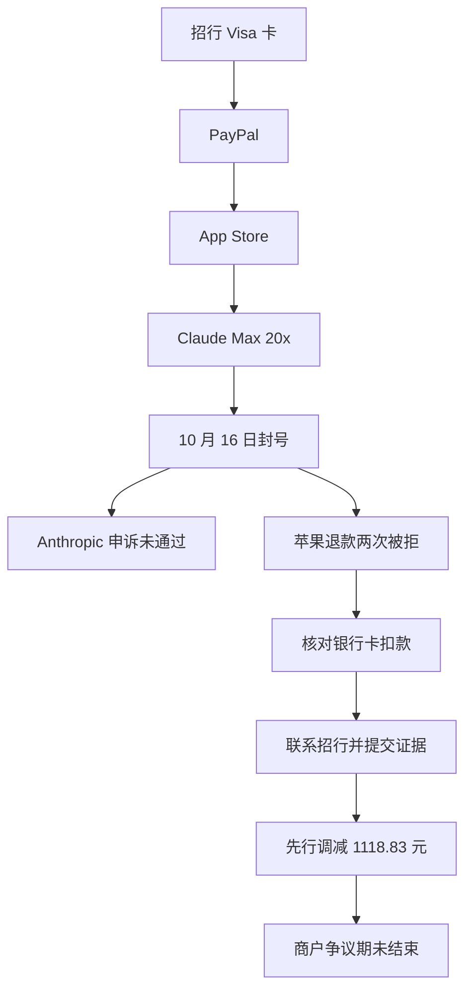

# Claude Max 20x 用了 9 天就封号：苹果两次拒退后，我怎样拿到 1118.83 元争议调减

10 月 7 日，我花 **US$249.99** 买了一个月 Claude Max 20x。用了 **9 天**，账号被封。苹果退款申请 **两次被拒**，我以为剩下二十多天的订阅费要打水漂。

后来我找到信用卡发卡行招商银行，提交账单和封禁通知。银行对一笔 **1678.25 元**的信用卡交易，先作了 **1118.83 元争议调减**。注意：商户争议期还没结束，这不是最终退款结果。

## 一张图看懂我的申诉路线

图上方是**付款链**，下方是**申诉链**。找银行时，关键是找出信用卡上对应的那笔扣款。[Visa 官方也指引持卡人联系发卡行](https://usa.visa.com/support.html)。

## 两次封号，退款结果却不同

- **4 月 9 日**开通 Pro；**5 月 28 日**起订阅 Max 20x，正常使用到 8 月。
- **9 月 27 日**第一个账号被封，离到期约一天。苹果按比例退了 **US$16.13**。
- **10 月 7 日**第二个账号购买 Max 20x，**10 月 16 日**再被封。订阅本应到 **11 月 7 日**。

第二次购买时，我用中国护照通过了美区 KYC；封禁邮件和申诉回复都没有说明具体违规行为。我不能确定封号原因。

## 苹果拒退后，我做对了哪几步

**1. 留下拒退记录。** 我在[苹果“报告问题”页面](https://support.apple.com/en-us/118223)申请，第一次被拒。电话转接等了约 40 分钟，客服帮我再提交一次；10 月 17 日仍被拒。再打电话又等约 40 分钟，客服说这笔订单无法提交第三次申请。这只是我这笔订单的经历。

**2. 找到银行卡上的扣款。** 我对照 App Store、PayPal 和招行账单，确认日期与金额，再向招行说明这笔交易。

**3. 请银行转给争议处理人员。** 第一位客服不熟悉，我讲清“本人授权付款，但订阅期内账号被停用”，请其转专人。约两到三个工作日后，专人回电；我在招行 App 提交封禁邮件和苹果账单。再过约两个工作日，银行短信通知调查期间调减 **1118.83 元**。

苹果记录购买日为 10 月 7 日，银行短信记账日为 10 月 8 日；向银行咨询时，以银行卡账单上的交易为准。

打电话可以照着说：

> “X 日我用这张卡支付了 X 元订阅，原定 X 日到期，X 日起账号无法使用。我有账单、封禁通知和退款申请结果。请问能否提出交易争议？需要什么材料？能否转给处理这类争议的同事？”

**别把自己授权的交易说成盗刷。** 真正有用的是四样证据：**购买账单、订阅到期日、封禁通知、平台处理结果。**

我先在 PayPal 开了争议，后又找银行；这只是我的时间线。PayPal 美国购买保障条款不允许同一笔购买同时在 PayPal 和发卡行追索，也不能重复获偿。已有案件时，要告知另一方并确认如何处理。[PayPal 条款](https://www.paypal.com/us/legalhub/buyer-protection)

## 付款前，给自己留一条退路

我的付款方式是 **招行 Visa 卡 → 美区 PayPal → App Store**。好处是有银行卡流水，遇到争议还能询问发卡行。礼品卡充值成 Apple 余额后，退款通常仍回到余额，兑现也受限制。付款前要看**实际扣款来源**，不是只看绑定了什么卡。[Apple 退款说明](https://support.apple.com/en-us/118224)

但“美区 PayPal”不能照抄：美国 PayPal 个人账户要求开户者是美国或其领地居民；Apple、Claude 也有地区规则。通过 KYC 不代表这些要求都满足。[PayPal 协议](https://www.paypal.com/us/legalhub/paypal/useragreement-full) · [Anthropic 支持地区](https://www.anthropic.com/supported-countries)

**截至 2026 年 10 月 21 日：**1118.83 元仍是调查期间调减，商户还有争议期；PayPal 案件当时仍在处理中。最终结果如有变化，我会更新。邮件图仍显示邮箱、付款方式图仍显示账单地址，暂未上传。

## 授权

文章文字采用 [CC BY 4.0](https://creativecommons.org/licenses/by/4.0/deed.zh-hans) 授权。引用时请署名并附上仓库链接。第三方平台名称与商标归各自权利人所有；截图仅为事实记录，不随文章文字开放再许可。
